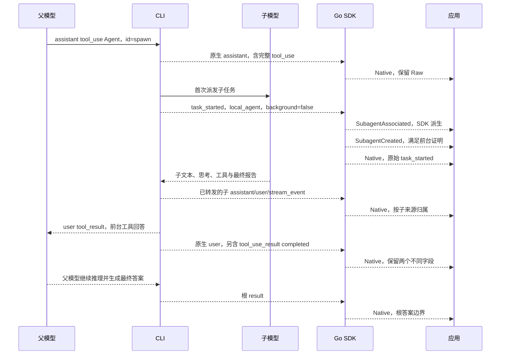
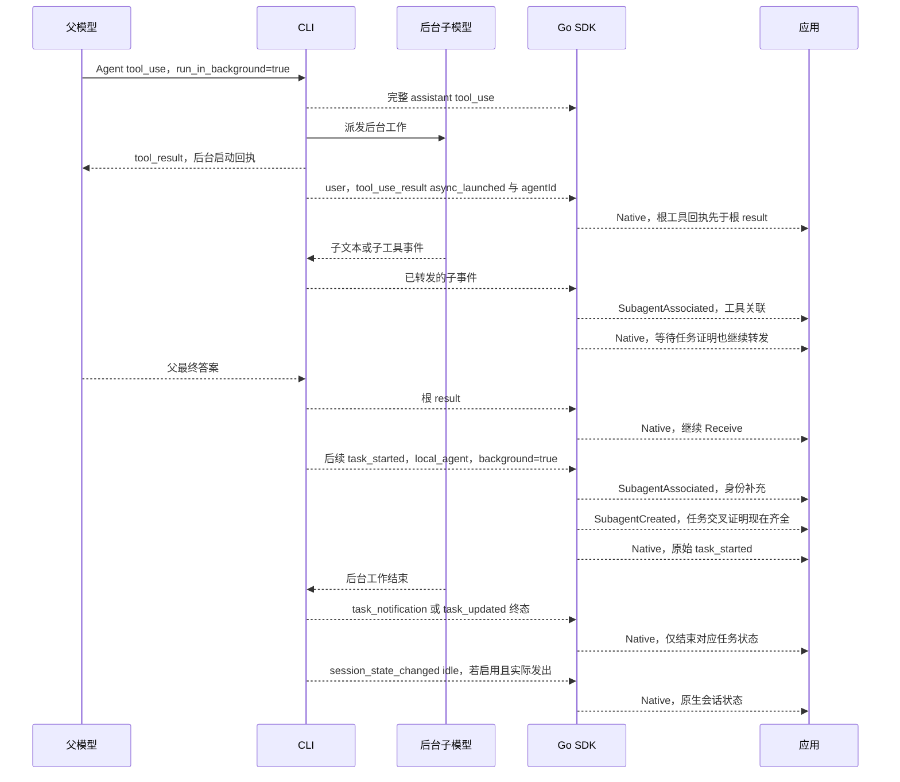
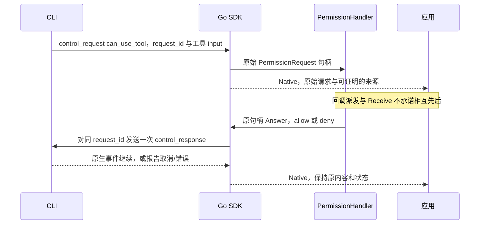

# Claude 事件时序：当前 CLI 2.1.258

本页说明一次根会话中的派任务、工具返回、子流、审批和结束边界。
2026-10-18 只读执行 `/Users/jim/bin/claude --version`，返回 **2.1.258**。
依据是官方 SDK **0.3.258** 声明和本机二进制静态复核；本票没有运行真实模型。
[固定来源与测试证据](evidence/subagent-ticket06.md)记录了哈希和限制。
下文 JSON 都是按原生字段编写的原创示例，**不是 live trace**。
图表示一种允许处理的次序，不是唯一序列，也不是承诺所有 CLI 都会发齐事件。

## 先区分三层

| 层 | 例子 | 谁消费、表达什么 |
| --- | --- | --- |
| 父模型的工具调用与回答 | assistant 的 tool_use；user 的 tool_result | CLI 把工具回答交给发起调用的模型。一次工具返回不等于根 turn 的最终答案。 |
| CLI 原生观测事件 | assistant/user、system/task_started、task_notification、task_updated、result | 原生流发给 SDK。tool_use_result 是 user envelope 上的结构化工具输出；它与给模型的 tool_result.content 不同。 |
| Go SDK 托管包装 | Native、SubagentAssociated、SubagentCreated、ObservationState | OpenTree.Receive 返回给应用。只有 Native 包含原始 Event/Raw；后三种是 SDK 派生记录，不发送给模型或 CLI。 |

普通 `Open/Client.Receive` 返回原生 Event。`OpenTree/TreeClient.Receive` 自动在
initialize 请求中开启 forwardSubagentText，随后只用一个消费者读取根托管流。
成功的 initialize 应答并不证明当前进程实际转发了所有子文本；首个包装记录是
`ObservationState(unverified, forwarding-not-confirmed)`。

## 前台 Agent：先调用，后得到完整工具回答

父模型发出 builtin Agent 的 tool_use。CLI 注册 local_agent 任务，执行子模型，
并在工具调用返回后把回答交给父模型继续推理。`task_started` 是注册/启动证据，
不是“模型已经执行完”。显式 `is_backgrounded:false` 在当前固定契约中排除恢复任务；
结合完整 builtin 请求、原生 task/tool 身份和无冲突的可归属关系，SDK 可以提前确认 Created。
仅有工具名、input、首次看到 ID 或 SubagentStart hook 都不够。



该图不规定 `task_notification`、终态 patch、最后一段子文本、工具返回在不同来源间的
全局先后。SDK 接受它们交错到达，不根据某一条推导另一条已经发生。
完整的 foreground 结果通常带最终报告和统计；`completed` 结构化结果只有在与同调用
local_agent 证据吻合时，才可作为另一条创建确认路径。

## 后台 Agent：工具返回可以只是派发回执

后台 Agent 的工具回答可能是 `async_launched` 回执，说明任务已经交给后台执行，
并非任务最终报告。父模型可以继续调用其他工具、派第二个 Agent，或先返回根 result。
应用需要继续调用 Receive，才能看到后续子文本、任务终态和待回答请求。

当前 0.3.258 的 SDKResultMessage 明确规定：result 在**该 turn 自己的**
assistant/user/stream_event 之后。因此，根 Agent 的结构化工具回执应在根 result 之前；
不能用“没有跨来源全序”放宽同一 turn 的这个约束。子 turn 或后续后台工作的消息是另一范围。

下面用**后续任务证据补齐**说明 Created 晚确认：工具回执已经在根 result 前到达，
子流按工具关联继续交付；随后 task_started 系统事件补齐 local_agent 交叉证明。
这表示 SDK 可处理的合成观察次序，不声称真实 CLI 必然延迟 task_started；
也可能因稍后建立的祖先/工具归属证据而晚确认。



创建证明按 session + tool_use_id 匹配完整 builtin 请求与**唯一一个**成功的 tool_result，
读取同 envelope 的结构化 tool_use_result，再用同调用 local_agent task_id 交叉核验 agentId。
SDK 的匹配器对请求、结果和 task_started 做乱序健壮性测试；这不代表原生生产者
允许任意排列同一 turn 的消息。同名、同 description 的并行任务仍按 ID 区分。
`remote_launched`、SendMessage、resume 键、错误结果、多个结果块或身份冲突均不能用于该证明。
PreToolUse/PermissionRequest 可以替换 input，不能因为请求里没有 resume 就断言新建成功。

子模型也可以再发 Agent。其 tool_use 属于该子模型；已观察到的工具归属把孙任务连到
直接父节点。缺少这条证据时保留 unresolved，不根据名字或 spawn_depth 猜父节点。
子源之间可交错；根答案不拼接子文本，usage 不自行相加。

## 字段示例：工具回执与最终任务状态不同

父模型发起的原生 assistant：

```json
{"type":"assistant","session_id":"s","parent_tool_use_id":null,"message":{"role":"assistant","content":[{"type":"tool_use","id":"spawn","name":"Agent","input":{"description":"inspect local source","prompt":"Inspect source","run_in_background":true}}]}}
```

CLI 的任务注册事件；当前不要求或虚构 run_id：

```json
{"type":"system","subtype":"task_started","session_id":"s","uuid":"started","task_id":"child","tool_use_id":"spawn","task_type":"local_agent","description":"inspect local source","is_backgrounded":true}
```

后台工具回执：content 给模型阅读，tool_use_result 是供客户端读取的结构化输出。
二者不应互相解析替代。`async_launched` 不应在界面上显示为任务“已完成”。

```json
{"type":"user","session_id":"s","parent_tool_use_id":null,"message":{"role":"user","content":[{"type":"tool_result","tool_use_id":"spawn","content":"Agent launched in background"}]},"tool_use_result":{"status":"async_launched","isAsync":true,"agentId":"child","description":"inspect local source","prompt":"Inspect source","outputFile":"/synthetic/child.output"}}
```

转发的子文本可以只带 parent_tool_use_id；应用不能自行把它改名为 agent_id：

```json
{"type":"assistant","session_id":"s","parent_tool_use_id":"spawn","message":{"role":"assistant","content":[{"type":"text","text":"child progress"}]}}
```

之后原生任务通知才表达一次任务的结束结果；失败/停止也必须保留原状态：

```json
{"type":"system","subtype":"task_notification","session_id":"s","uuid":"finished","task_id":"child","tool_use_id":"spawn","status":"completed","output_file":"/synthetic/child.output","summary":"Inspection complete"}
```

也可能先后收到 `task_updated.patch.status`，已知终态为 completed/failed/killed。
notification 的已知终态为 completed/failed/stopped。`killed` 保持 killed，不能擅自改写为 stopped。
最终报告、工具回答和任务状态是不同数据；不要用“最后一段文本看起来结束了”代替终态事件。

## 等待审批或问答：仍用原请求回答



AskUserQuestion 只有在原生 can_use_tool 请求中出现时，才能经原句柄提供回答。
assistant 中一个叫 AskUserQuestion 的 tool_use 本身不是可回答句柄。
回调与 Native 包装不会产生两份回答权；默认拒绝、超时、取消和连接 epoch 约束保持不变。
control_cancel_request、关闭或断线会使待处理句柄失效，不能移到新连接重发。
SDK 不因自动跟随子流而自动批准工具。

原生会话状态可以报告 requires_action。但界面需要回答什么、能否回答，应看原始请求和句柄，
不能只看这个状态。客户端控制读取/回调派发不会为了等待子来源关联而被有界关系缓冲挡住。

## result、idle、任务终态、停止和删除

当前 0.3.258 声明确认 session_state_changed 的 running/requires_action/idle，
本机二进制也静态确认它受 **CLAUDE_CODE_EMIT_SESSION_STATE_EVENTS** 开关控制。
需要时通过 Options.Env 设置 `CLAUDE_CODE_EMIT_SESSION_STATE_EVENTS=1`；非 nil Env
替换整个环境，应由调用方保留需要继承的其他项。OpenTree 不自动设置此开关。
本票没有启动真实会话验证它的实际输出。

当前声明把 idle 描述为 heldBackResult 刷出、后台 agent 循环退出后的 turn-over 信号。
它是独立的原生状态事件，SDK 不根据 result、安静、超时或任务列表空来合成 idle。
后台/ambient 任务与会话活动指示也不能混成一个全局“全部完成”位。

| 观察/操作 | 可以说明什么 | 不能据此说明什么 |
| --- | --- | --- |
| 根 result | 根 turn 的结果/最终答案边界 | 子任务均完成、没有审批、流已关闭 |
| 子任务明确终态 | 对应任务完成、失败或停止；保留原值 | agent 被删除、所有后代结束、根会话关闭 |
| 原生 idle | 当前原生会话的 turn-over 状态 | 所有 task/ambient 工作成功、实体被删除 |
| 空 background_tasks_changed.tasks | 用该快照替换后台列表 | 缺席任务完成、失败、停止或删除 |
| Interrupt 应答 | CLI 确认中断请求 | 每个子任务已停止、工作回滚、实体被删除 |
| Receive(ctx) 取消 | 本次本地等待结束 | Provider 工作已停止、子任务成功 |
| TreeClient.Close | 关闭拥有的进程和本地观察、失效待处理句柄 | Provider 侧删除或任务成功 |
| EOF/断线 | 本次观察结束/不完整 | 安全完成、无事件丢失、可自动续接 |

本 SDK 没有子 agent 删除 API，也不从完成或停止推导删除。父与子状态独立；
父最终答案先到时，后台子工作和权限服务仍可继续。

## 保证的偏序与不保证的顺序

以下是本地托管 API 的保证，条件是记录被正常接纳且没有触发显式资源失败：

- 对一个已归属的子 Native，先发布所需的 Associated；已知祖先先建立关联。
- Created 只有证明齐全后才发布；同一合并实体至多一次。它可以在 Associated、子文本、
  父 result 之后到达。记录的 Sequence 是本地交付顺序，不是原生创建时刻。
- 每个已交付 Native 保留原始 Raw。SDK 不为补关系重放已交付的文本；重复无 ID delta
  不按内容去重。有可靠原生身份的重复才在当前 epoch/来源范围内去重。
- 未归属事件只在数量、字节和等待时限内暂存；到限后报告 incomplete，再交付 unresolved
  Native。控制请求和底层应答服务保持独立。因此“原生到达顺序”和“包装交付顺序”不能等同。

当前原生契约保证同 turn 的 result 在该 turn 的 assistant/user/stream_event 之后；
后续系统通知仍可到达。SDK 缓冲/派生包装的交付顺序与这条原生生产顺序是不同层次。

以下没有保证：不同子源之间的全局顺序、task_started 一定先于第一段子文本、
所有终态/工具回答/最后文本之间的全序、Created 一定早于子输出，以及跨连接 exactly-once。
SDK 不凭时间戳、名字、深度、result 或 idle 猜测缺失事件。

## run、恢复和断线缺口

**当前 CLI 2.1.258 的固定消息/任务声明没有 run_id、parent_task_id 或消息 agent_id。**
本票的 Created 只填写有证据的 task/tool ID，Source.RunID 为空，RunScope 为 legacy-unknown；
不为一次恢复编造新的原生 run ID。前几票保留的可选类型和新增原生字段仍可无损透传，
对应的新版本离线 fixtures 不代表当前版本会发这些字段。

SendMessage 可以继续已存在的 agent；它不能证明新建。根 ResumeID 和 History 种子只做
显式恢复/历史关联；本观察不发 Created。History 记录使用 history provenance，
不是实时 Native 重放。isReplay、重复 init、会话变化或身份冲突会关闭本 epoch 的后续创建判定。
SDK 不自动重启进程、恢复子任务、重放用户输入或权限回答。调用方显式重新 OpenTree 会得到
新 epoch；原句柄和去重历史不能跨过去。没有 cursor 的断线是永久观察缺口；未标记历史也不能
凭首次出现 ID 被可靠识别。兼容矩阵不声称无缝补流或跨 epoch 恰好一次。

可直接执行[离线示例](../examples/subagents-offline/main.go)查看实际 SDK 包装顺序：
它使用原创合成 peer，输出 13 条 Native 和 2 条 Created，包含前台孙任务、后台晚确认、
父 result 之后子文本、patch-only killed 和显式 Close。
[API 与界限](subagent-events.md)及[能力矩阵](subagent-compatibility.md)列出完整边界。
