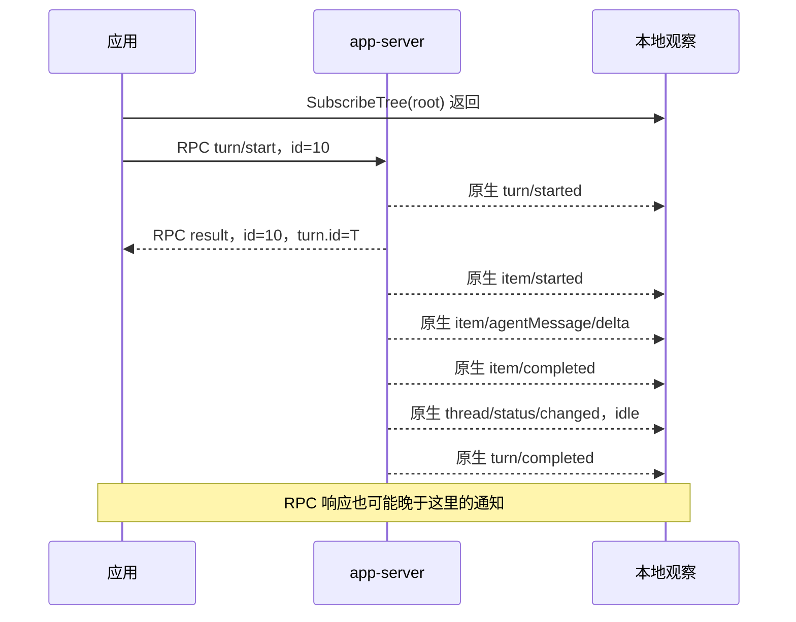
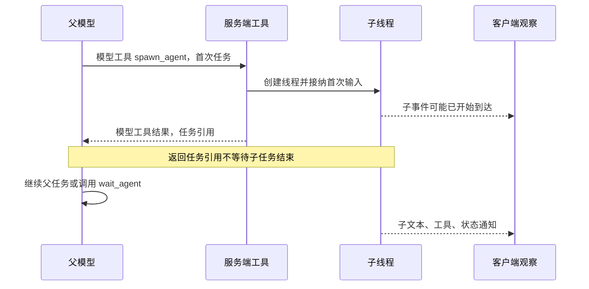
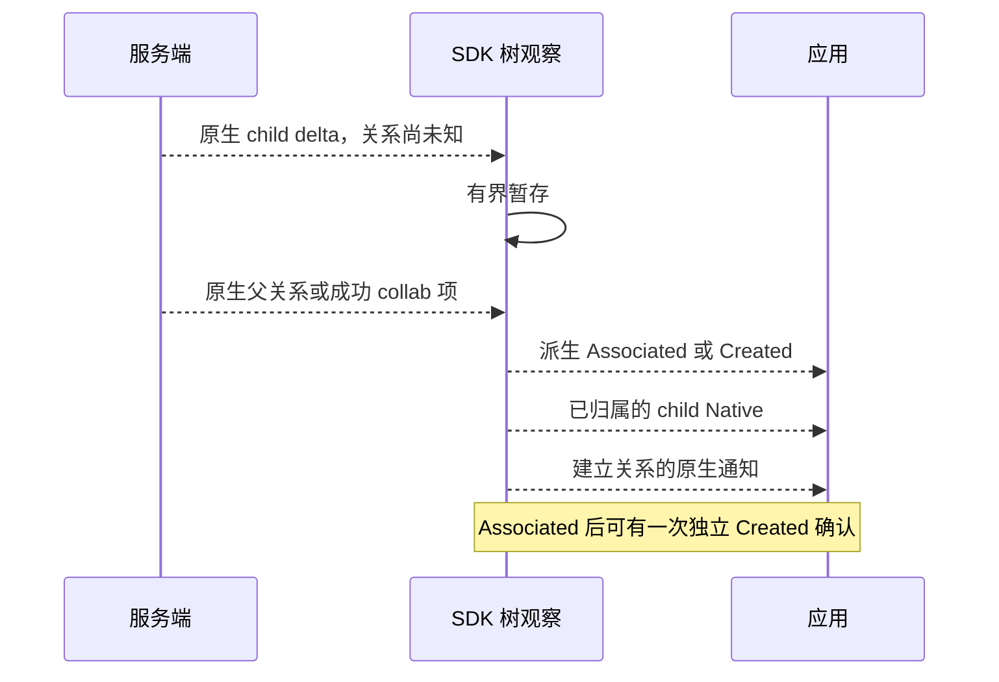
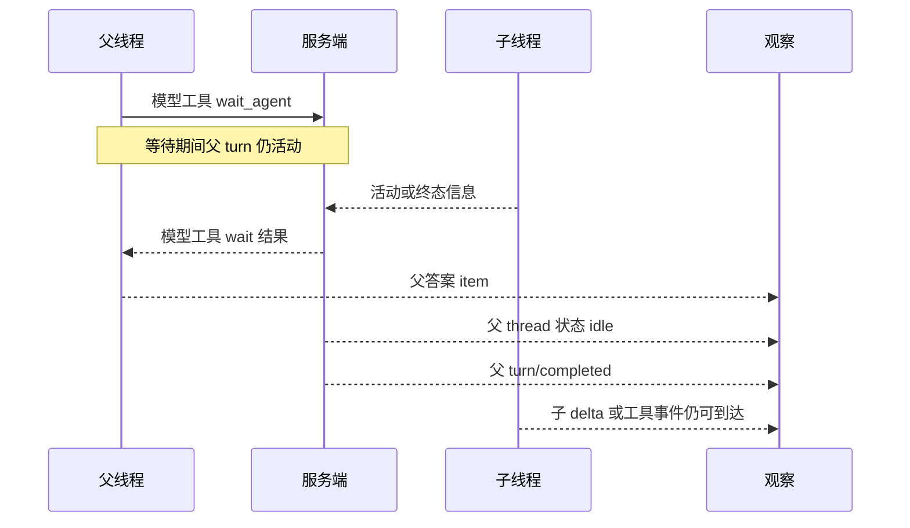
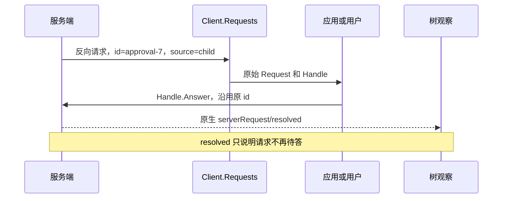
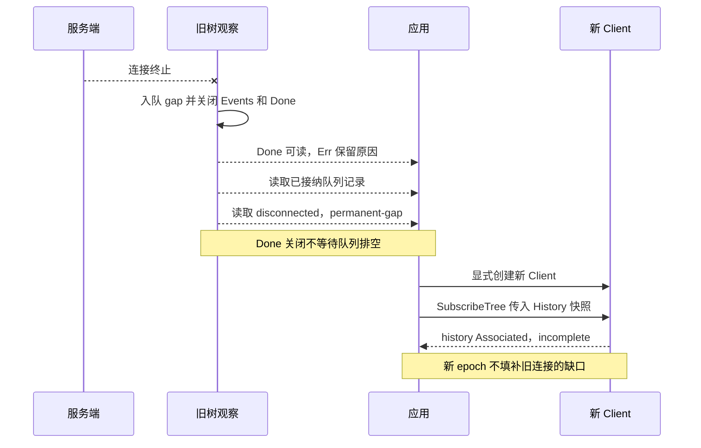

# Codex 事件时序

本文对应本机 **Codex CLI 0.162.1**。
源码固定为 [`092d3acd6bec3e3a14bdc7e7a2810ab628ab759d`](https://github.com/openai/codex/tree/092d3acd6bec3e3a14bdc7e7a2810ab628ab759d)。
[当前版本核对](evidence/subagent-05-current.md)记录来源和离线结果。
本文没有新增真实模型调用。

图中的箭头展示一种允许的顺序。
只有“保证的偏序”表中的约束属于保证。
服务端、父模型和子模型可能并发工作。
跨线程的箭头位置不表示全局先后关系。

示例沿用当前原生字段。
示例中的 `root`、`child` 和数字是教学占位符。
示例不是 live 抓包。

## 先分清 4 类对象

| 对象 | 例子 | 接收位置 | 含义 |
| --- | --- | --- | --- |
| 客户端 RPC 请求和响应 | `turn/start`、相同 `id` 的 `result` | `StartTurn` 返回值 | 服务端回答一次调用 |
| 模型工具调用和结果 | `spawn_agent`、`wait_agent` 的返回文本 | 父模型上下文 | 工具向模型交付任务引用或状态 |
| 原生通知 | `item/completed`、`turn/completed` | `Subscribe` 或树中的 `Native` | 服务端发布的执行事件 |
| SDK 派生记录 | `SubagentCreated`、`SubagentAssociated`、`ObservationState` | `SubscribeTree` | SDK 解释关系或报告观察缺口 |

模型工具结果不是客户端 RPC 响应。
`SubagentCreated` 不是原生 method。
`item/completed` 只结束指定 item。
某个工具完成不等于子 turn 完成。

`threadId` 标识线程，`turnId` 标识一次工作。
`itemId` 或 `item.id` 标识工作项。
`rootTurnId` 标识因果链的起始 turn。
SDK 不把 `rootTurnId` 改名为根线程 ID。
`agentPath` 只提供显示线索。
SDK 不从路径字符串推断父线程。

## 普通 turn

先注册观察，再发送工作。
`StartTurn` 的响应和通知独立到达。
通知可能早于响应，甚至先到达完成通知。
[公开 API 测试](../turn_contract_test.go)覆盖这个边界。



客户端请求和响应示例：

```json
{"id":10,"method":"turn/start","params":{"threadId":"root","input":[{"type":"text","text":"检查实现","text_elements":[]}]}}
{"id":10,"result":{"turn":{"id":"T","rootTurnId":"T","items":[],"status":"inProgress"}}}
```

通知示例：

```json
{"method":"item/agentMessage/delta","params":{"threadId":"root","turnId":"T","itemId":"answer","delta":"检查结果"}}
{"method":"item/completed","params":{"threadId":"root","turnId":"T","completedAtMs":2,"item":{"type":"agentMessage","id":"answer","text":"检查结果","phase":"partial_answer"}}}
{"method":"thread/status/changed","params":{"threadId":"root","status":{"type":"idle"}}}
{"method":"turn/completed","params":{"threadId":"root","turn":{"id":"T","rootTurnId":"T","items":[],"status":"completed"}}}
```

`partial_answer` 允许后续输出和工具调用。
`final_answer` 表示模型声明的终局答案阶段。
应用仍须检查原生 turn 终态和观察错误。
SDK 不拼接父子文本，也不生成树级最终答案。

## spawn 已派发首次任务，返回不等待任务完成

0.162.1 同时包含 V1 和 V2 工具模式。
这些模式属于同一版本的功能配置。
本文不维护旧版本兼容分支。

V1 `spawn_agent` 以 `message/items` 提交首次输入。
V2 `spawn_agent` 以 `message/task_name` 提交首次任务。

服务端完成启动和输入接纳后返回任务引用。
返回不等待子任务最终结果。
这里的“立即返回”没有固定延迟承诺。
调用方无需再派发一次相同的首次任务。
子任务也可能在工具结果返回前完成。



V2 模型工具输入、结果示例：

```json
{"task_name":"research","message":"核对边界","fork_turns":"none"}
{"task_name":"/root/research","nickname":"Maple"}
```

V1 的模型工具结果形状不同：

```json
{"agent_id":"child","nickname":"Maple"}
```

V1 源码把原生线程 ID 写入 `agent_id`。
V2 的 `task_name` 是任务路径，不能当作线程 ID。
模型工具的参数不是客户端 `turn/start` 参数。
SDK 不代替模型调用这些工具。

源码依据：[V1 spawn](https://github.com/openai/codex/blob/092d3acd6bec3e3a14bdc7e7a2810ab628ab759d/codex-rs/core/src/tools/handlers/multi_agents/spawn.rs)、[V2 spawn](https://github.com/openai/codex/blob/092d3acd6bec3e3a14bdc7e7a2810ab628ab759d/codex-rs/core/src/tools/handlers/multi_agents_v2/spawn.rs)、[首次输入接纳](https://github.com/openai/codex/blob/092d3acd6bec3e3a14bdc7e7a2810ab628ab759d/codex-rs/core/src/agent/control/spawn.rs#L927-L961)。

## 关系通知、Created 和乱序暂存

SDK 只用明确证据建立父子关系。
原生父线程字段、thread_spawn 来源和成功 collab 项提供证据。
SDK 在子 Native 前发布已经证实的关系。
SDK 先宣布祖先，再释放已经归属的后代记录。
冲突保留已接纳的父关系并报告 incomplete。
循环证据只产生诊断。



图中最后 2 条 Native 的顺序只是一个示例。
它们取决于暂存记录和建立关系的通知。
已先交付的原生记录不会重排。

`Created` 只采用实时成功的 `spawnAgent` collab 完成项。
失败 spawn 和非 spawn collab 不能证明新建。
已有 Associated 可收到一次 Created 确认。
两条记录复用 `RelationKey`。
历史 seed 只产生 Associated。

**当前 V2 限制：**V2 spawn 把 collab 项送给 analytics。
V2 向执行事件流发布 `SubAgentActivity.started`。
SDK 不能据此声称实体新建。
有原生谱系时，SDK 发布 Associated。
缺少谱系时，子流可能保持 unresolved。
这里没有宣称 V2 必定收到 Created。

V2 活动通知形状：

```json
{"method":"item/completed","params":{"threadId":"root","turnId":"T","completedAtMs":3,"item":{"type":"subAgentActivity","id":"spawn-call","kind":"started","agentThreadId":"child","agentPath":"/root/research","model":"selected-model","reasoningEffort":"high"}}}
```

活动通知的 `threadId` 标识发布活动的父线程。
`agentThreadId` 标识活动对象。
应用不能合并这 2 个身份。

这里同时出现 `item/completed` 和 `kind=started`。
前者结束活动记录，后者说明活动种类。
两者都没有宣称子 turn 已完成。
[活动发布器](https://github.com/openai/codex/blob/092d3acd6bec3e3a14bdc7e7a2810ab628ab759d/codex-rs/core/src/tools/handlers/multi_agents_v2.rs#L44-L52)连续发布 item started/completed。

无法关联的记录有数量、字节和等待上限。
达到上限时，SDK 发布 `incomplete/unresolved-source`。
SDK 将原始 Native 标为 `Scope=unresolved`。
这类记录可能属于另一棵树。
后续关联不会重放已经交付的 Native。
无 source 的通知保留为 `unscoped`。

`Raw` 保留通知信封，`Native.Params` 保留参数字节。
`Sequence` 只表示本地交付顺序。
暂存可能改变不同 source 之间的交付位置。
相同文本 delta 仍可连续出现 2 次。
窄范围的终态 item 去重不提供全局 exactly-once。

依据：[树实现](../tree.go)、[乱序与去重测试](../tree_nested_test.go)、[当前模式 metadata 测试](../tree_current_contract_test.go)。

## 父子状态独立，wait 不关闭父 turn

父线程 idle 和子线程 active 可以同时成立。
父 turn 完成不会关闭树观察。
子 turn 结束不会删除 agent 实体。
同一子线程仍可能接收新的工作。



在当前 `TurnComplete` 路径中，服务端先等待
`note_turn_completed`，再调用 `handle_turn_complete`。
需要状态变化时，前者发布该线程的 idle。
后者再入队该线程的 `turn/completed`。
状态代码没有聚合子线程状态。
这不建立跨线程或所有失败路径的全局顺序。

源码依据：[TurnComplete](https://github.com/openai/codex/blob/092d3acd6bec3e3a14bdc7e7a2810ab628ab759d/codex-rs/app-server/src/bespoke_event_handling.rs#L185-L202)、[线程状态](https://github.com/openai/codex/blob/092d3acd6bec3e3a14bdc7e7a2810ab628ab759d/codex-rs/app-server/src/thread_status.rs#L148-L158)。
离线依据：[父 idle、子 active 测试](../tree_lifecycle_test.go)。

V1 wait 返回观察到的终态映射和 `timed_out`。
V1 wait 不保证一次等齐所有目标。
V2 wait 可因邮箱活动、新输入或超时返回。
V2 wait 结果不等于某个子 turn 已成功。
[两种 wait 实现](https://github.com/openai/codex/tree/092d3acd6bec3e3a14bdc7e7a2810ab628ab759d/codex-rs/core/src/tools/handlers)区分这些条件。

当前 V2 wait 的模型工具结果示例：

```json
{"message":"Wait completed.","timed_out":false}
```

后台完成还有独立的父线程回传路径。
控制器根据原生终态构造完成消息。
满足条件时，控制器还发布 completed 活动记录。
控制器用 `trigger_turn=false` 投递完成消息。
投递成功表示接纳入队，未必已经消费。
父线程空闲时，回传不强制启动新的父 turn。

父模型上下文中的完成消息示例：

```text
Message Type: FINAL_ANSWER
Task name: /root
Sender: /root/research
Payload:
核对结果
```

这个文本不是 app-server 的新 method。
SDK 不把这个文本合成为父最终答案。
回传和订阅流都可能存在缺口。
不能仅靠回传缺失判断子任务失败。

源码依据：[完成回传](https://github.com/openai/codex/blob/092d3acd6bec3e3a14bdc7e7a2810ab628ab759d/codex-rs/core/src/agent/control/completion.rs)、[消息格式](https://github.com/openai/codex/blob/092d3acd6bec3e3a14bdc7e7a2810ab628ab759d/codex-rs/core/src/context/inter_agent_completion_message.rs)、[入队路径](https://github.com/openai/codex/blob/092d3acd6bec3e3a14bdc7e7a2810ab628ab759d/codex-rs/core/src/agent/control.rs#L253-L323)。

## 权限与用户问答使用原请求句柄

服务端反向请求带原生 RPC `id`。
`Client.Requests()` 是唯一请求入口。
树中的关系记录没有回答权限。
应用通过原始 `Request.Handle()` 回答一次。
SDK 不自动批准或回答问题。



命令权限的原生 request-response 示例：

```json
{"id":"approval-7","method":"item/commandExecution/requestApproval","params":{"threadId":"child","turnId":"child-turn","itemId":"command","startedAtMs":1,"command":"pwd","cwd":"/tmp"}}
{"id":"approval-7","result":{"decision":"decline"}}
{"method":"serverRequest/resolved","params":{"threadId":"child","requestId":"approval-7"}}
```

示例中的拒绝是调用方明确选择。
成功写出回答不是服务端成功执行的确认。
中断或服务端解决请求也可产生 resolved。
resolved 的晚到通知不会撤回已接纳的回答。

用户问答沿用相同的原始句柄规则：

```json
{"id":"question-1","method":"item/tool/requestUserInput","params":{"threadId":"child","turnId":"child-turn","itemId":"question-tool","isBlocking":true,"questions":[{"id":"choice","header":"选择","question":"使用 A 吗？"}]}}
{"id":"question-1","result":{"answers":{"choice":{"answers":["A"]}}}}
```

关闭或取消树观察不使请求句柄失效。
请求取消、过期、resolved 或断线保留原有语义。
新连接上的相同 request ID 不能复用旧句柄。
事件队列满时，原始请求与 RPC 路由仍独立工作。

依据：[原请求语义](../requests.go)、[满队列与句柄测试](../tree_bounds_requests_test.go)、[原生处理路径](protocol/README.md#server-request-resolution)。

## 停止工作、关闭观察和删除历史不是同一操作

| 操作 | 影响对象 | 可用边界 |
| --- | --- | --- |
| `InterruptTurn(threadId, turnId)` | 显式请求中断指定 turn | RPC 确认不等于已经停止；检查原生终态 |
| 模型工具 `interrupt_agent` | V2 当前任务 | 属于模型工具；SDK 没有同名客户端 RPC |
| 模型工具 `close_agent` | V1 agent 及可达存活后代 | 服务端关闭运行时并标记已关闭关系；不等于删除持久历史 |
| `TreeSubscription.Close()` 或观察 context 取消 | 本地观察 | 不发送 interrupt、resume 或 unsubscribe |
| `UnsubscribeThread(threadId)` | 原生连接对线程的附着 | 不删除线程，也不证明 turn 停止 |
| `Client.Close()` | Client 拥有的连接或进程 | stdio 按已有所有权关闭子进程；远端只关闭连接 |
| 原生 `thread/delete` | 服务端持久线程数据 | 当前有子树删除路径；SDK 没有专用 wrapper，也没有新增删除流程 |

`thread/closed` 和 `thread/deleted` 也不是同一通知。
应用不能从父答案或空闲状态推断删除。
树观察原样转发可归属的原生通知。
树观察不会因活动 completed 删除关系节点。

依据：[显式关闭](https://github.com/openai/codex/blob/092d3acd6bec3e3a14bdc7e7a2810ab628ab759d/codex-rs/core/src/agent/control/legacy.rs#L47-L112)、[V2 中断工具](https://github.com/openai/codex/blob/092d3acd6bec3e3a14bdc7e7a2810ab628ab759d/codex-rs/core/src/tools/handlers/multi_agents_v2/interrupt_agent.rs)、[原生删除](https://github.com/openai/codex/blob/092d3acd6bec3e3a14bdc7e7a2810ab628ab759d/codex-rs/app-server/src/request_processors/thread_delete.rs)。
这些服务端操作的源码存在不等于本 SDK 提供完整工作流。

## 断线与恢复缺口



原生新线程 auto-attach 是 best-effort。
服务端漏过创建广播时会跳过 resync。
SDK 每次观察都先报告 incomplete。
SDK 没有通用自动补订阅或重连循环。

历史快照只提供已知关系。
历史快照不重放 Native，也不证明实时新建。
新连接不自动 resume、read、list 或启动旧子线程。
显式 resume 是独立操作，不能冒充无副作用的监听。
新 epoch 可能再次收到相同原生 ID。
SDK 不保证跨 epoch exactly-once。

观察尚未终止时，预留位置保留断线诊断。
慢观察者溢出只终止该观察者。
`Done()` 关闭不等待消费者排空队列。
应用仍能读取已经接纳的记录。
应用必须检查 `Done()` 和 `Err()`。
收到父完成记录不能掩盖观察丢失。

依据：[新线程附着与跳过 resync](https://github.com/openai/codex/blob/092d3acd6bec3e3a14bdc7e7a2810ab628ab759d/codex-rs/app-server/src/lib.rs#L1291-L1319)、[历史与断线测试](../tree_lifecycle_test.go)、[原始交互与有界观察](../tree_bounds_requests_test.go)。

## 保证的偏序与不保证的全局顺序

| 范围 | 有依据的约束 | 不能推出的结论 |
| --- | --- | --- |
| 启动观察 | 返回 `SubscribeTree` 时本地注册完成 | 注册之前的通知会补发 |
| 当前 spawn | 首次输入已接纳后返回任务引用 | 子任务已完成，或子事件一定晚于工具结果 |
| 关系交付 | 已证实关系先于归属该子线程的 Native | Created 总会出现，或所有连接通知都属于这棵树 |
| 当前 TurnComplete 路径 | 有变化时，同线程 idle 入队早于 turn/completed | 所有子任务完成，或所有异常路径都有同样通知 |
| RPC 关联 | 响应沿用原 request ID | 响应一定先于通知，或成功响应表示工作成功 |
| 权限回答 | 原句柄最多一次接纳回答 | resolved 证明批准、执行成功或费用产生 |
| 本地 Sequence | 表示本观察交付顺序 | 服务端持久 cursor 或跨 source 因果顺序 |
| 关闭观察 | 释放本地观察，保留已接纳队列 | provider 工作自动取消 |
| 断线 | 明确 permanent-gap，保留终止原因 | 无缝补流或跨 epoch exactly-once |

[兼容矩阵](subagent-compatibility.md)区分源码 E1 和离线 E2。
源码检查没有验证真实服务端路由覆盖率。
离线假进程没有验证模型行为。
本轮没有 E3/E4 子代理运行证据。
ACP 子代理提案仍是草案参考。

[离线示例](../examples/observe-tree-offline/README.md)能重现树交付顺序。
示例只启动自己的假服务端。
