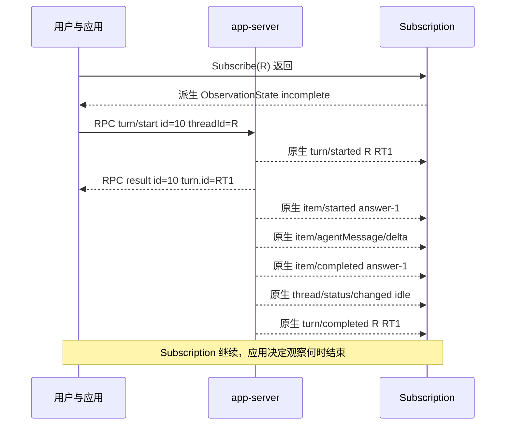
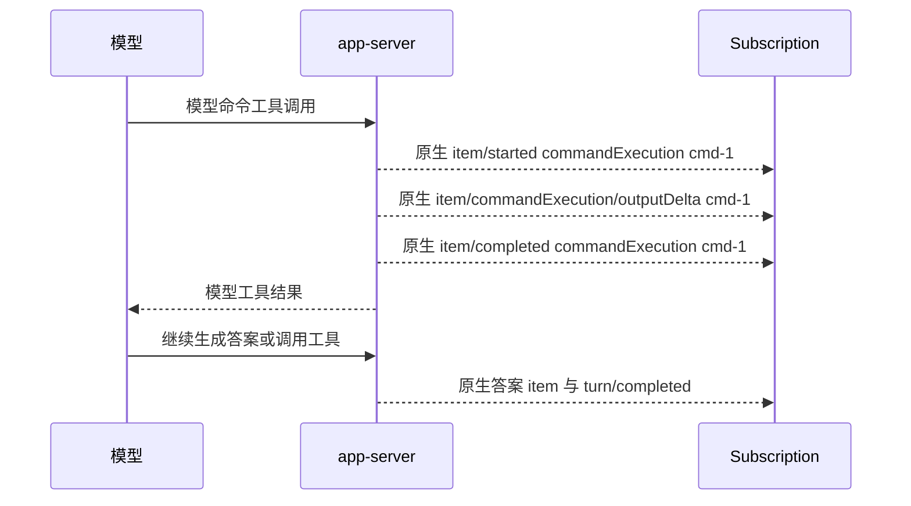
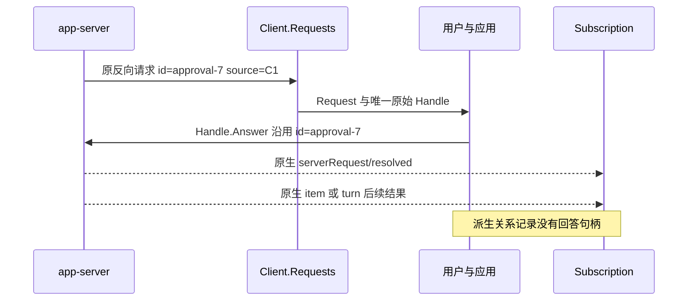
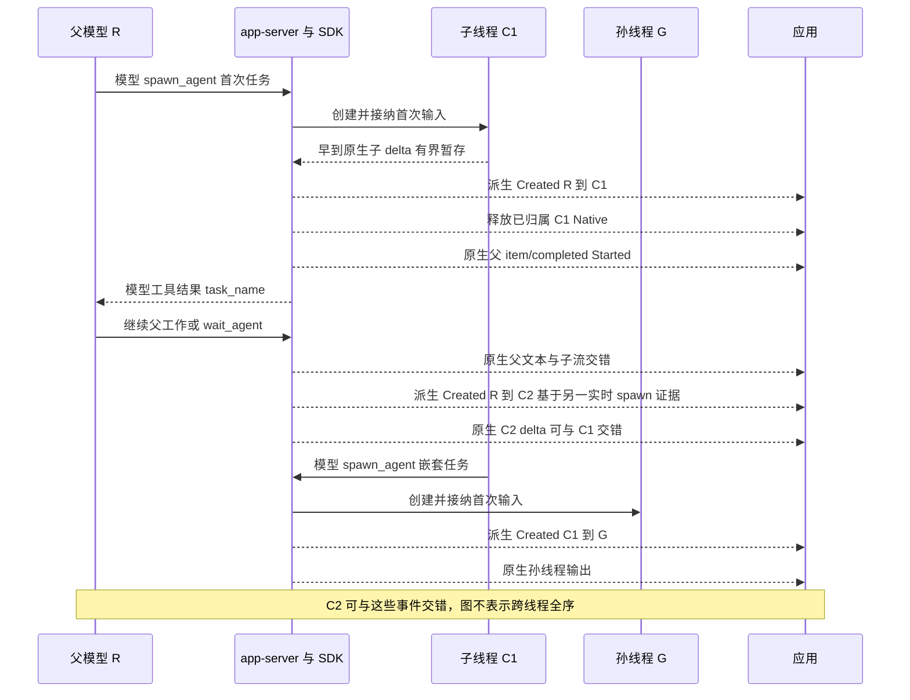
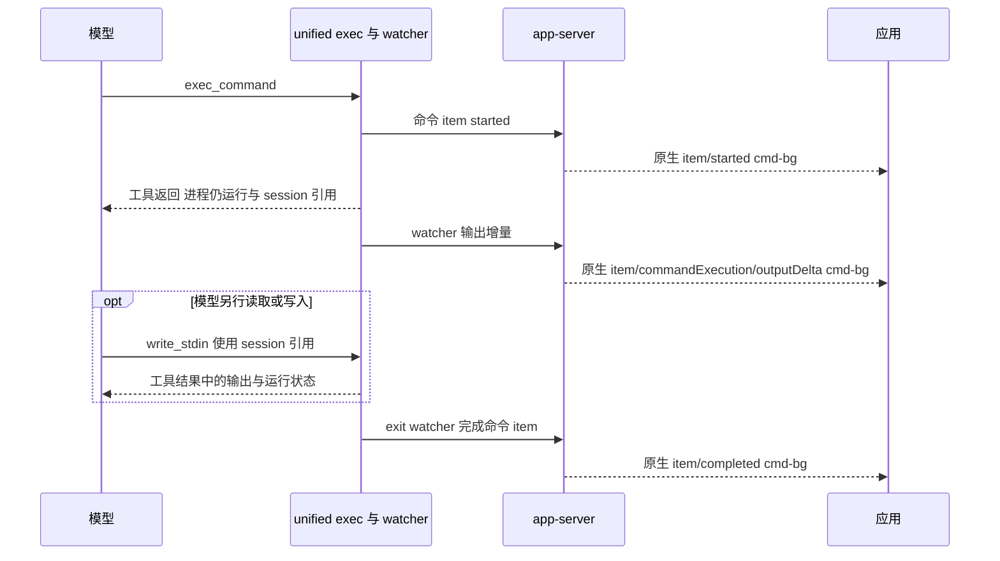
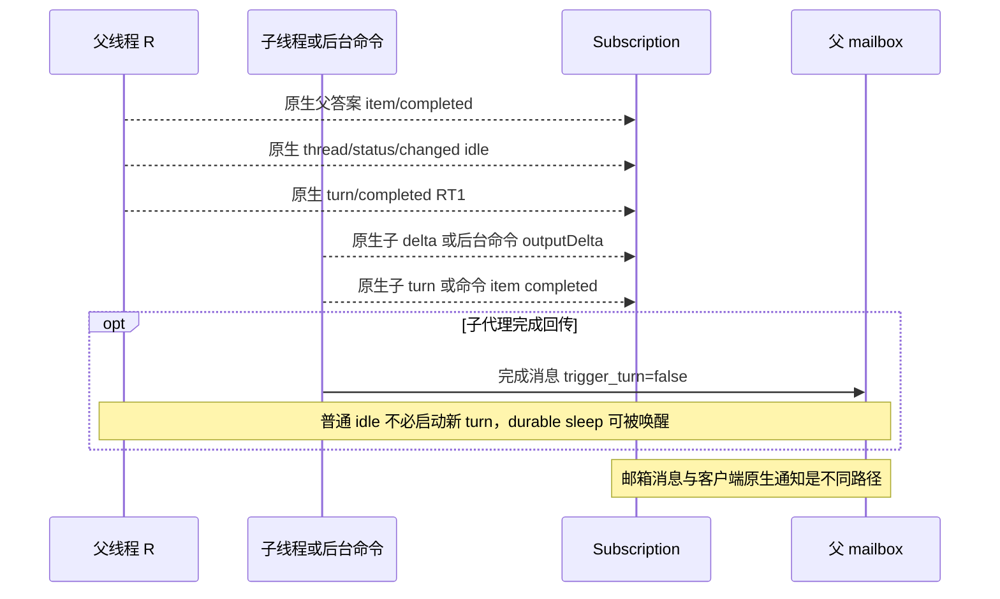
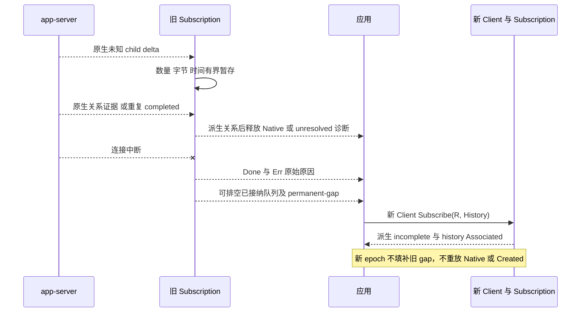

# 从用户动作看 Codex 事件时序

本文固定 **Codex CLI 0.162.1**，源码为 [`092d3acd6bec3e3a14bdc7e7a2810ab628ab759d`](https://github.com/openai/codex/tree/092d3acd6bec3e3a14bdc7e7a2810ab628ab759d)。以下是源码与离线假服务端合约支持的故事，不是真实录制；本票不运行模型。真实录制另票执行。[当前来源核对](evidence/subagent-05-current.md)、[兼容矩阵](subagent-compatibility.md)区分源码、离线与 live 证据。

每个图是一种允许的顺序，不是跨线程全序。RPC result 只回答相同 `id` 的调用，可以晚于执行通知。模型工具结果进入模型上下文，不是客户端 RPC result。以下图中的「原生」通知通过 `TreeNative` 包装交付；「派生」是 SDK 记录，不是服务端 method。

应用先取得原生根线程 ID，再调用 `Subscribe(ctx, rootID, TreeOptions{})`，返回后再 StartTurn。Events 返回 TreeEvent，初始派生记录为 `ObservationState(incomplete, best-effort-auto-attach-unverified)`。原生载荷在 `record.Native`，完整通知字节在 `record.Raw`；派生记录的 Native/Raw 为空。Kind/Origin 仅属于 SDK wrapper，未向原生 JSON 注入字段。通知不回放。

| 身份 | 示例 | 客户端用途 |
| --- | --- | --- |
| RPC id | `10`、`approval-7` | 请求响应关联，反向请求仍用原句柄回答 |
| threadId | `R`、`C1`、`G` | 根、子、孙线程独立实体 |
| turnId / turn.id | `RT1`、`CT1` | 同一线程某次工作，不能代替 threadId |
| itemId / item.id | `answer-1`、`cmd-1` | 增量与完成项的关联键 |
| rootTurnId | `RT1` | 因果链起始 turn，不能当作根线程 ID |
| agentThreadId | `C1` | V2 活动的对象；通知 threadId 仍是发布活动的父线程 |
| agentPath / task_name | `/root/research` | 显示路径；不能据此猜父关系或原生线程 ID |

## 1. 用户提交普通任务，看到答案并结束本次工作

**用户动作：** 用户输入「检查实现」。应用持有线程 `R`，先注册 Subscribe，再调用 `StartTurn`。Requests 由独立循环处理。



**原生与派生序列：** 初始观察诊断之后，普通文本任务只需原生 turn/item/delta。没有子关系证据时，不产生 Created/Associated。通知可能全部早于 turn/start result。

```json
{"id":10,"method":"turn/start","params":{"threadId":"R","input":[{"type":"text","text":"检查实现","text_elements":[]}]}}
{"id":10,"result":{"turn":{"id":"RT1","rootTurnId":"RT1","items":[],"status":"inProgress"}}}
{"method":"item/agentMessage/delta","params":{"threadId":"R","turnId":"RT1","itemId":"answer-1","delta":"检查结果"}}
{"method":"item/completed","params":{"threadId":"R","turnId":"RT1","completedAtMs":2,"item":{"type":"agentMessage","id":"answer-1","text":"检查结果","phase":"final_answer"}}}
{"method":"turn/completed","params":{"threadId":"R","turn":{"id":"RT1","rootTurnId":"RT1","items":[],"status":"completed"}}}
```

**结束依据：** `item/completed` 只结束 answer-1。`turn/completed` 的原生 status 才说明 RT1 的完成、失败或中断；仍要检查观察 Err/缺口。`partial_answer` 可继续有工具和文本，`final_answer` 是模型的答案阶段声明。

**客户端更新：** 按 `(threadId, turnId, itemId)` 为增量更新文本；完成项作为该 item 的最终快照，避免再把完整文本追加一次。将 RPC result 存为独立调用结果，将 RT1 终态存在线程 R 下。

**禁止推断：** 文本停止、final_answer、idle 和 RPC 成功都不能单独证明 turn 成功或整棵树完成。关闭观察不等于停止工作。

依据：[turn 合约测试](../turn_contract_test.go)、[当前 TurnComplete 路径](https://github.com/openai/codex/blob/092d3acd6bec3e3a14bdc7e7a2810ab628ab759d/codex-rs/app-server/src/bespoke_event_handling.rs#L185-L202)。在该路径中，需要变化时，同线程 idle 先入队，再 turn/completed；不推广到跨线程或所有异常路径。

## 2. 用户要求执行工具，查看输出与工具结果

**用户动作：** 用户要求检查目录。模型选择命令工具；应用不需要另发一个 turn/start 才让命令执行。若需要权限，进入故事 3。



**原生与派生序列：** 这里没有新增的 SDK「工具完成」派生事件。命令执行的客户端通知是 `item/started`、`item/commandExecution/outputDelta` 和 `item/completed`。例如输出增量 `params={"threadId":"R","turnId":"RT1","itemId":"cmd-1","delta":"README.md\n"}`。完成的 commandExecution item 保留原生 `id`、`status`、`aggregatedOutput`、`exitCode` 等字段（按实际 payload 读取）。其他工具使用各自的原生 item 类型，不假装都有命令输出。

**结束依据：** cmd-1 的 completed item 和 status/exitCode 是该命令的结果；应用继续等 RT1 的 turn 终态。工具调用成功返回给模型与模型最终答案是不同边界。

**客户端更新：** 为 cmd-1 显示运行状态，按 itemId 更新输出缓冲，用 completed item 校准最终快照与退出状态。`outputDelta` 当前在 SDK 中为 raw-only，读取 Native.Params；commandExecution 完成项可通过 `*types.ItemCompletedNotification` 的 union 读取。未知字段、类型保留 Raw/Params。

**禁止推断：** 工具 item 完成不是 turn 完成，也不是所有子线程完成。命令无输出不能证明无执行或成功。不要把内部 Rust `ExecCommandEnd` 当作唯一客户端线协议 method；当前 v2 映射使用规范 item 生命周期。

依据：[原生 method 注册](https://github.com/openai/codex/blob/092d3acd6bec3e3a14bdc7e7a2810ab628ab759d/codex-rs/app-server-protocol/src/protocol/common.rs)、[输出通知映射](https://github.com/openai/codex/blob/092d3acd6bec3e3a14bdc7e7a2810ab628ab759d/codex-rs/app-server-protocol/src/protocol/event_mapping.rs)、[item 生命周期处理](https://github.com/openai/codex/blob/092d3acd6bec3e3a14bdc7e7a2810ab628ab759d/codex-rs/app-server/src/bespoke_event_handling.rs)。

## 3. 用户回答权限或问题，再观察实际结果

**用户动作：** 应用向用户展示服务端请求，用户明确拒绝命令，或选择问题答案。应用调用 Requests 中原始 Request.Handle().Answer；SDK 不自动批准。



**原生与派生序列：** 原请求不从 Events 再分发为第二个可答请求。子线程关系已知时，后续原生 resolved/item/turn 通知按 C1 路由。关系记录不改变请求或其原生 ID。

```json
{"id":"approval-7","method":"item/commandExecution/requestApproval","params":{"threadId":"C1","turnId":"CT1","itemId":"cmd-1","startedAtMs":1,"command":"pwd","cwd":"/tmp"}}
{"id":"approval-7","result":{"decision":"decline"}}
{"method":"serverRequest/resolved","params":{"threadId":"C1","requestId":"approval-7"}}
{"id":"question-1","method":"item/tool/requestUserInput","params":{"threadId":"C1","turnId":"CT1","itemId":"question-tool","isBlocking":true,"questions":[{"id":"choice","header":"选择","question":"使用 A 吗？"}]}}
{"id":"question-1","result":{"answers":{"choice":{"answers":["A"]}}}}
```

**结束依据：** Answer 成功只确认 SDK 沿原请求路径写出一次回答；resolved 表示不再待答。实际执行结果继续看对应 item/turn 终态。取消、过期、中断、服务端解决和断线仍按原句柄契约处理。

**客户端更新：** 用原 request ID 维护待答 UI，保留 thread/turn/item 上下文。并发 Answer 最多一次接纳；resolved 后清除待答状态，不伪造命令成功。

**禁止推断：** resolved 不等于批准或执行成功。观察 Close/cancel/满队列既不回答也不取消原请求；新 epoch 相同 request ID 不能复用旧句柄。Created/Associated 没有权限权威。

依据：[原请求语义](../requests.go)、[审批竞争、观察取消与满队列测试](../tree_bounds_requests_test.go)。

## 4. 用户委派并行任务，查看子线程与嵌套孙线程

**用户动作：** 用户要求并行核对两项工作。父模型选择 spawn_agent，为子线程提交首次输入；子模型还可以继续委派孙线程。模型工具返回引用无需等待子任务结束，应用不重复发送首次任务。



**原生与派生序列：** V1 成功实时 `spawnAgent` collab completed item 的 receiver IDs 可确认 Created；其他成功 collab 只证明 Associated。V2 使用成功解码的实时 `item/completed`，其活动 `kind=started`，从通知 threadId 和活动 agentThreadId 建立关系并确认 Created。固定源码在创建和接纳首次输入成功之后发布它；不依赖 `thread/started`。SDK 原样保留真实 `TreeEvidence.Activity`，不伪造成 collab。

```json
{"method":"item/completed","params":{"threadId":"R","turnId":"RT1","completedAtMs":3,"item":{"type":"subAgentActivity","id":"spawn-1","kind":"started","agentThreadId":"C1","agentPath":"/root/research","model":"selected-model","reasoningEffort":"high"}}}
{"method":"item/agentMessage/delta","params":{"threadId":"C1","turnId":"CT1","itemId":"child-answer","delta":"子结果"}}
```

对应 SDK 记录的关键值为 `Kind=SubagentCreated, Source.ThreadID=C1, ParentThreadID=R, RelationKey=C1`，Evidence.Source 是 `(R, RT1, spawn-1)`。原生 thread 父字段或 thread_spawn 来源也可证明 Associated。已知祖先关系先于已归属后代 Native；早到孙关系在祖先证实后按祖先顺序宣布。先 Associated 后可单独确认一次 Created，复用 RelationKey。

V2 模型工具结果形如 `{"task_name":"/root/research","nickname":"Maple"}`；V1 为 `{"agent_id":"C1","nickname":"Maple"}`。前者路径不是线程 ID。这些文本不是客户端 RPC。

**结束依据：** C1/CT1、C2/CT2 和 G/GT1 分别从各自原生 turn 终态确定结果。父模型 wait_agent 的返回不是整棵树完成：V1 可只收到部分终态，V2 可因邮箱、新输入或超时返回。

**客户端更新：** 用 RelationKey 建树，用 Evidence 展示直接父证据；按 Source.ThreadID 分别显示文本、工具、状态、usage，不聚合 token 或拼接答案。冲突保留已接纳关系并显示 incomplete。关系节点在活动结束后仍保留，可继续接收新 turn。

**禁止推断：** `item/started`、活动 Interacted/Interrupted/Completed 不证明创建或父关系；历史 Started 只关联，不成为实时 Created。`item/completed` 加 `kind=started` 是活动项结束，不是子 turn 结束。路径、缺失 thread/started、父答案和 wait 返回都不能推断全树完成。SDK 不新增 child start/resume/turn/read/list/subscribe RPC 或额外连接。

依据：[V2 成功 Started](https://github.com/openai/codex/blob/092d3acd6bec3e3a14bdc7e7a2810ab628ab759d/codex-rs/core/src/tools/handlers/multi_agents_v2/spawn.rs#L185-L239)、[首次输入接纳](https://github.com/openai/codex/blob/092d3acd6bec3e3a14bdc7e7a2810ab628ab759d/codex-rs/core/src/agent/control/spawn.rs#L923-L959)、[官方无 collab 测试源码](https://github.com/openai/codex/blob/092d3acd6bec3e3a14bdc7e7a2810ab628ab759d/codex-rs/app-server/tests/suite/v2/turn_start.rs#L4493-L4593)、[离线 V2 正负例](../tree_v2_contract_test.go)、[嵌套与去重](../tree_nested_test.go)。本票未运行官方 Rust 测试。

## 5. 用户启动耗时命令，持续查看后台输出

**用户动作：** 用户请求耗时检查。模型调用 unified exec，首次等待窗口结束时进程仍运行；模型工具收到 session/process 引用，可以继续推理或调用 write_stdin。



**原生与派生序列：** 客户端的输出增量和完成 item 来自 watcher 路径，不要求模型轮询 write_stdin 才有通知。模型侧 write_stdin 读取是另一条工具结果路径；它的 session/process 引用不能替换客户端 `(threadId, turnId, itemId)`。SDK 没有为后台命令制造派生 completed method。

固定源码每个输出 delta 至多 8192 字节，数量受 `MAX_EXEC_OUTPUT_DELTAS_PER_CALL=10000` 限制，聚合 transcript 也受缓冲策略限制。watcher 等待进程退出、输出 drain 和相关监视条件后，通过工具 emitter 发布完成项。内部代码中的 ExecCommandEnd 是实现事件名，当前 app-server v2 的客户端边界仍是原生 commandExecution item 生命周期与 outputDelta；不能把内部名当作唯一线协议。

**结束依据：** cmd-bg 的 completed item/status/exitCode 是该进程的终态依据；首次工具返回引用或某次 write_stdin 返回仍在运行都不是结束。超时、失败也要按实际原生字段呈现。

**客户端更新：** 维持独立命令条目，逐次显示收到的 outputDelta，用 completed item 的聚合输出校准末态。输出缺口或截断应显式显示，不能宣称收到完整 stdout/stderr。不要把模型工具结果和客户端增量再混合追加，造成重复输出。

**禁止推断：** delta 配额耗尽或输出静默不代表进程结束；模型不再读取也不代表 watcher 停止。SDK 缓冲有界不等于 provider 输出无限可靠，断线后不补齐输出。

依据：[后台与 exit watcher](https://github.com/openai/codex/blob/092d3acd6bec3e3a14bdc7e7a2810ab628ab759d/codex-rs/core/src/unified_exec/async_watcher.rs)、[delta 数量上限](https://github.com/openai/codex/blob/092d3acd6bec3e3a14bdc7e7a2810ab628ab759d/codex-rs/core/src/exec.rs)、[进程管理与 write_stdin](https://github.com/openai/codex/blob/092d3acd6bec3e3a14bdc7e7a2810ab628ab759d/codex-rs/core/src/unified_exec/process_manager.rs)。这些是固定源码依据，本票没有后台 shell live 录制。

## 6. 用户看到父答案，但后台工作尚未结束

**用户动作：** 用户收到父线程的答案后继续留在任务视图，等待子任务或后台命令完成。应用保持 Subscription 和 Requests 循环运行。



**原生与派生序列：** 根 idle/turn/completed 不关闭本地观察。后续 C1 的文本、工具、终态和原请求仍可到达；根线程上的 cmd-bg 也可以在 RT1 结束之后报告自身完成。已有关系不会因完成删除，SDK 不合成全树终态。子代理完成回传可伴随父侧 Completed 活动项，但该活动不是子 turn 终态的替代品。

子代理控制器把完成文本以 `trigger_turn=false` 投递父 mailbox。接纳入队不等于父模型已消费；普通 idle 无需自动开新 turn。存在 outstanding durable sleep 时，队列消息可唤醒该 sleep，这是必须单独区分的例外。完成回传中的 `Message Type: FINAL_ANSWER / Task name / Sender / Payload` 是模型上下文消息，不是 app-server 新 method。

**结束依据：** 父 RT1、子 CT1 和后台 cmd-bg 的终态各自独立。应用若要显示「当前已知工作全部结束」，必须显式定义观察范围、所有已知 turn/item 的终态及完整性条件；SDK 初始 incomplete 和永久 gap 限制了完整性声明。用户也可以主动结束本地观察，但这不停止 provider 工作。

**客户端更新：** 父面板显示 idle/RT1 completed，子面板与命令条目保持运行状态；后续更新各自实体。不要自动让父答案变成子答案。保持原 Requests 的审批 UI 可用。

**禁止推断：** 根 idle、父 final_answer、Completed 活动、无 mailbox 回传或一段静默，都不能推断全树成功、失败、删除或父必然继续生成。普通完成回传不得被描述成无条件唤醒父 turn。

依据：[父 idle 子 active 离线测试](../tree_lifecycle_test.go)、[完成回传](https://github.com/openai/codex/blob/092d3acd6bec3e3a14bdc7e7a2810ab628ab759d/codex-rs/core/src/agent/control/completion.rs)、[mailbox 与 trigger_turn](https://github.com/openai/codex/blob/092d3acd6bec3e3a14bdc7e7a2810ab628ab759d/codex-rs/core/src/agent/control.rs#L253-L323)、[durable sleep 例外](https://github.com/openai/codex/blob/092d3acd6bec3e3a14bdc7e7a2810ab628ab759d/codex-rs/core/src/tasks/mod.rs#L428-L490)、[输入处理](https://github.com/openai/codex/blob/092d3acd6bec3e3a14bdc7e7a2810ab628ab759d/codex-rs/core/src/session/handlers.rs)。

## 7. 用户经历交错、重复、缺失与断线后恢复观察

**用户动作：** 用户在网络中断后重开观察；应用明确创建新 Client，可从已有快照传入 History。SDK 不偷偷 resume 子线程或进行 read/list 补流。



**原生与派生序列：** 不同 source 交错；不明确来源的通知有界等待，超限/到期发布 `ObservationState(incomplete, unresolved-source)` 并以 `Scope=unresolved` 交付原生记录。无 source 的通知为 unscoped，不证明树成员。相同无 ID 文本 delta 可以重复两次；窄范围 item 终态去重不是全局 exactly-once。后续建立关系不会重放已交付 Native。冲突、循环和资源限制有诊断或终止错误。

观察仍活动时，非预期断线使用预留槽交付 `ObservationState(disconnected, permanent-gap)`，Done/Events 关闭，Err 保留原始原因；已接纳记录可排空。队列满先终止的观察不再继续收事件。新观察从 incomplete 开始，History 只导入 Associated 与 history-recovery-gap，从不把快照当实时创建或 Native 重放。

**结束依据：** Done/Err 是观察结束依据，不是工作成功/失败依据。单个慢订阅的 overflow/ErrLimit 只结束该观察，不阻塞连接、其他订阅或审批。Close/cancel 与断线保留第一终止原因。

**客户端更新：** 显示永久缺口，保留各 epoch 的身份关联与来源，分别记录本地 Sequence。保存 Raw/Params 供未知协议和损坏载荷排查；不要用 Marshal(Data) 代替收到的原始字节。重连后显式合并应用快照，保持「状态未知」而非假装完整恢复。

**禁止推断：** Sequence 不是 provider cursor，Epoch 不是持久 provider 身份；新 epoch 相同原生 ID 不提供 exactly-once。缺失通知、静默、EOF 或新的历史关系不证明任务结束或旧缺口已修复。Unknown 原生保留不等于支持其他服务端版本。

依据：[有界与原子 fanout](../tree_bounds_requests_test.go)、[断线、历史与 epoch](../tree_lifecycle_test.go)、[Raw、未知、缺失/null 与独立所有权](../tree_contract_test.go)、[离线示例](../examples/observe-tree-offline/README.md)。

## 用户主动停止与关闭的边界

| 用户意图与操作 | 实际结束对象 | 仍需观察或明确的边界 |
| --- | --- | --- |
| InterruptTurn(threadId, turnId) | 请求中断指定 turn | RPC 确认不等于已停止，检查原生终态 |
| 模型 interrupt_agent | V2 当前任务 | 模型工具，不是 SDK 同名 RPC |
| 模型 close_agent | V1 agent 与可达存活后代 | 不是删除持久历史 |
| Subscription.Close 或 context 取消 | 本地观察 | 不 interrupt/resume/unsubscribe，不影响原请求句柄 |
| UnsubscribeThread | 原生连接附着 | 不删除线程，不证明工作停止 |
| Client.Close | 所有权范围内连接/进程 | stdio 关闭拥有的子进程；远端只关闭连接 |
| 原生 thread/delete | 持久线程数据 | SDK 无专用 wrapper，不从父 idle 推断删除 |

所有故事的保证仅限显式 ID 关联、已证关系先于归属后代 Native、独立原句柄与有界可见失败。原生 auto-attach 在固定版本为 best-effort。SDK 不提供树级完成保证、自动恢复或新增子任务控制流程。参见 [API 迁移](default-managed-migration.md)。
