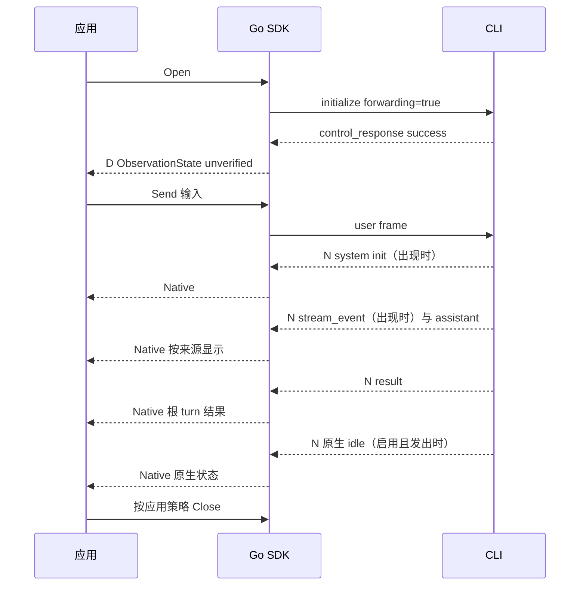
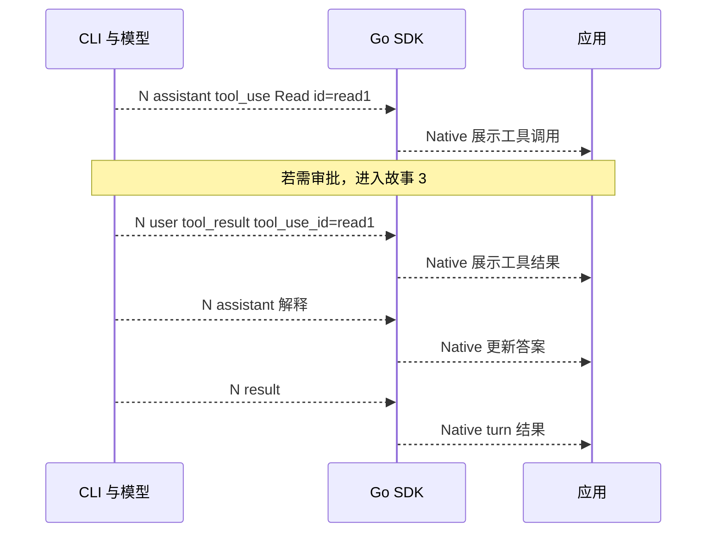
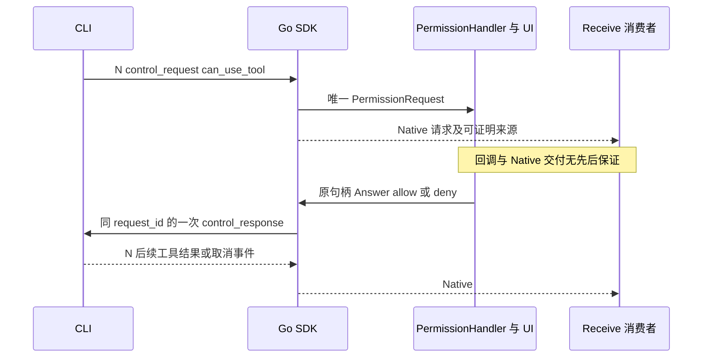
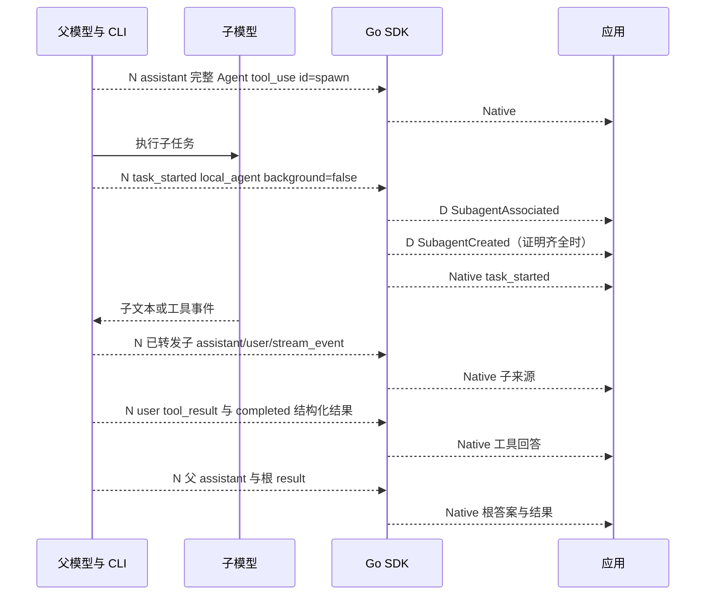
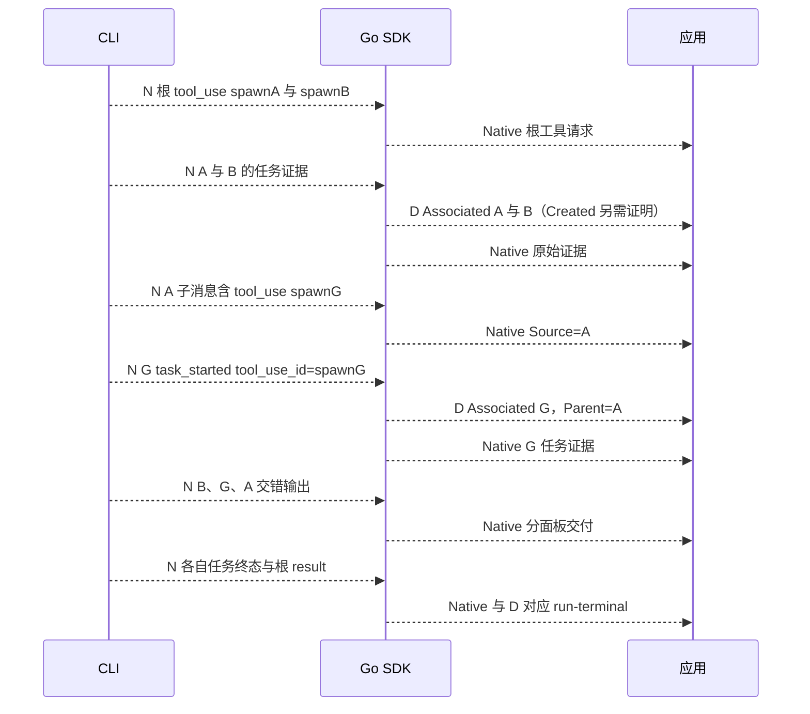
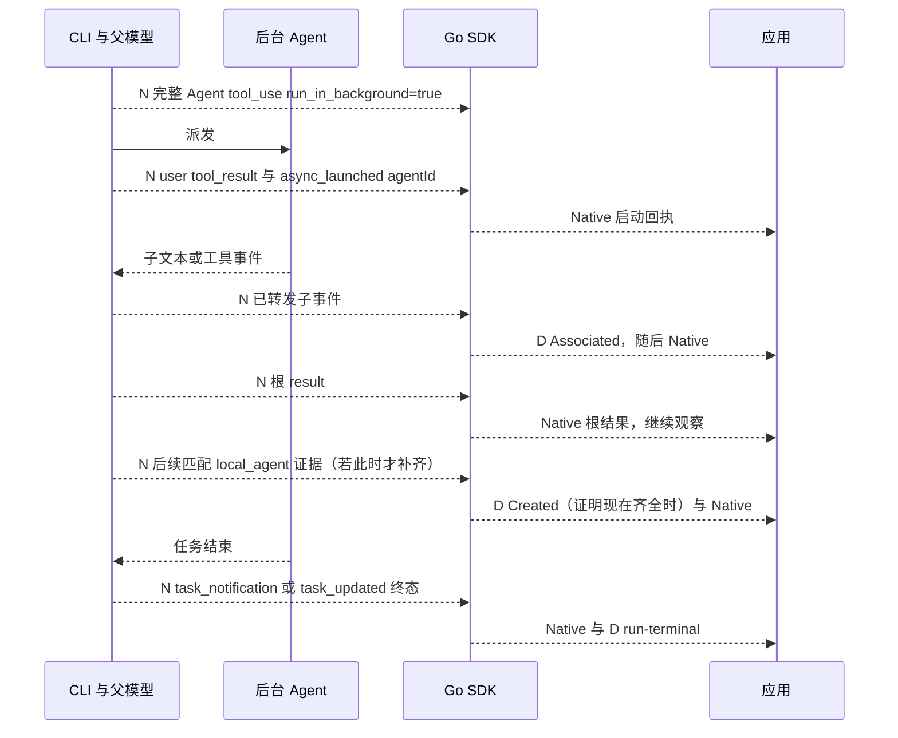
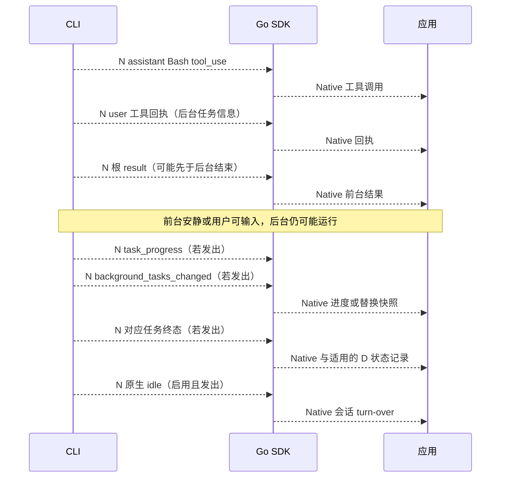
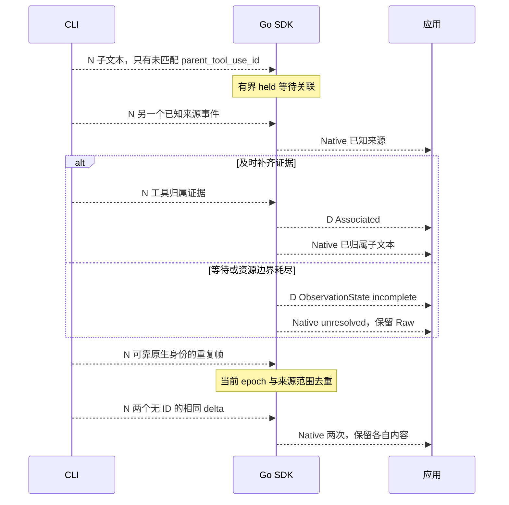
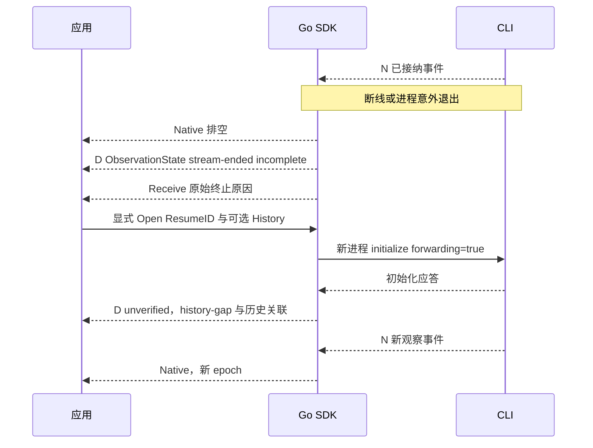

# 按用户故事理解事件流：CLI 2.1.258

本页依据固定的官方 SDK **0.3.258** 声明和已记录的 CLI **2.1.258** 静态证据。
[来源与限制](evidence/subagent-ticket06.md)保留原核查时点。本票只运行原创合成 peer，
**以下均为契约示意，不是真实模型录制**。每个故事可作为后续独立真实验证票的操作清单；
实际事件是否出现、身份字段、后台输出及精确先后均标记为**待真实验证**，不得把合成通过写成 live 通过。

唯一入口为 `Open(ctx, Options)`，返回 `*Client`；唯一 `Receive` 返回 `ReceivedEvent`。
`Open` 始终在 initialize 请求 `forwardSubagentText:true`，拒绝则启动失败。
接受应答仍只首发 `ObservationState(unverified, forwarding-not-confirmed)`，不证明子流完整。
`Options.Subagents` 仅设置资源和历史，不选择 raw/managed 模式。

图中 **N** 是直接返回的 CLI 原生 `Event`，保留精确 `Event.Raw`；**D** 是独立的便利事件，
包括 SubagentAssociated、SubagentCreated、ObservationState，不发给模型或 CLI。
用 Go type switch 分流；原生 `Event.Origin` 和 `Event.Result.Origin` 保持官方对象。
关系管理在内部进行，不在原生事件中添加分类字段。
图中省略非关键事件，箭头不是对跨来源全局顺序的保证。

## 故事 1：我输入一个普通任务，等待答案

**用户动作：** Open 后 Send「概括这段文本」，持续 Receive，按具体 Go 类型分流。

**何时结束：** 根 result 表示这个 turn 的结果；应用可在明确只等待根答案的策略下 Close，
或继续等待原生状态、后续任务和下一轮输入。result 不关闭 Client，也不等于 session idle。

**状态与输出：** Send 成功只表示完整本地写入。用 assistant 的完整消息维护答案，用 stream_event
维护流式显示，避免把累计完整消息和 delta 重复拼接。保留 result 的错误与 usage，不合并其他来源。
当前固定契约规定该 turn 的 result 在它自己的 assistant/user/stream_event 之后。

**禁止推断：** 文本看似结束、无输出或 Receive 超时都不代表完成。system init、流式分片、idle 的
具体出现与相互位置需真实验证；SDK 不补造缺少的事件。

## 故事 2：我让它读取文件或调用工具，再等待解释

**用户动作：** Send「读取指定文件并解释」，观察工具调用和工具回答，再显示模型的最终解释。

**何时结束：** tool_result 仅回答对应 tool_use，随后模型仍可继续推理或调用工具；根 result 才是
根 turn 的结果边界。失败工具回答也要原样保留，不能改成成功。

**状态与输出：** 用 tool_use_id 匹配，不按工具名匹配。user envelope 的 `tool_use_result` 是结构化
工具输出，`message.content` 中 tool_result.content 是给模型的内容，两者分别读取。
普通工具不产生 SubagentCreated。工具调用所在 Native 的 Source 决定显示在根还是子任务面板。

**禁止推断：** assistant tool_use 不是权限句柄；出现 Read/Bash 不证明正在等待用户，也不证明已执行。

## 故事 3：我批准、拒绝工具，或回答问题

**用户动作：** 为 Open 提供 PermissionHandler，将收到的原始请求交给 UI；用户明确决定后通过该句柄 Answer。
若工具是 AskUserQuestion，按原请求的问题与输入格式回答。

**何时结束：** 一次请求由原句柄的一次回答、CLI 取消、连接结束等原有终态结束；回答完成不等于 turn 完成。
关闭、断线、control_cancel_request 会使相应请求失效。Receive context 取消只结束该次等待。

**状态与输出：** UI 只保留原句柄，不从 Native 复制第二个 responder。权限服务独立于观察进度，
即使子来源未归属、Receive 阻塞或队列有压力也不等待 UI 消费 Native 才处理取消。
没有 handler 仍按原有拒绝/失败策略处理，托管不会自动 allow。requires_action 只展示会话状态。

**禁止推断：** 一个叫 AskUserQuestion 的 assistant tool_use 不是可回答句柄；requires_action 不说明
该回答哪个请求；旧 epoch 请求不能在恢复连接重发。用户未回答不能因超时被视为批准。

## 故事 4：我派前台 Agent，并查看子任务的工作

**用户动作：** Send 一个要求前台 builtin Agent 的任务，同时显示根和子任务面板。

**何时结束：** 前台 Agent 的工具回答让父模型继续；任务终态只终结对应任务状态，根 result 终结根 turn。
最后文本、任务通知和工具返回在不同来源间没有全局全序。

**状态与输出：** Associated 先于依赖它的已归属 Native。Created 只在固定创建证明齐全时发布，同一合并实体
至多一次，可以晚于子文本；不能为等 Created 阻塞输出。分开显示根答案、子文本、工具返回和各自 usage。

**禁止推断：** task_started、第一次看到 ID、名字、input 或 SubagentStart hook 都不单独证明新建。
创建要求精确 CLI 2.1.258、新 epoch、单 root init、稳定 session、builtin 完整请求及匹配 local_agent 证据。
resume（含 null 键）、历史、replay、冲突或重复 init 会禁止相应创建确认。详见[创建规则](subagent-events.md#creation-evidence)。

## 故事 5：我让多个子任务并行，其中一个再派孙任务

**用户动作：** 要求父任务并行派 A/B，并让 A 再派 G，分别跟踪进度。

**何时结束：** 各节点分别按原生终态更新；父 result 不结束子/孙观察，子终态也不证明后代均结束或实体被删除。

**状态与输出：** 工具归属证据建立直接父关系；先发布已知祖先关联。同名任务按身份分开；Source/Parent
未知时显示 unresolved。UI 用 AssociationID 跟踪后续身份补充和重定向，不重复重放已显示文本。

**禁止推断：** 不按名字、时间戳、spawn_depth 猜直接父节点。当前 2.1.258 固定声明没有 run_id、
parent_task_id 或消息 agent_id；不得为这些故事补造身份。可选新字段的离线测试不代表当前 CLI 会发送它们。

## 故事 6：我启动后台 Agent，让父模型先回答

**用户动作：** 要求 Agent 在后台工作，根答案先返回后继续 Receive。

**何时结束：** async_launched 是派发回执，不是子报告。对应任务终态才能更新该任务为完成/失败/停止；
根 result 后仍可能有子文本、工具、权限请求。子任务观察何时关闭由应用策略决定。

**状态与输出：** 同一根 turn 的工具回执必须在根 result 之前。图中晚到的是补齐创建证明的系统/祖先证据，
不是把同 turn 工具回执放到 result 后。Created 的交付序号不是实际创建时间。子文本不拼入父最终答案。

**禁止推断：** async_launched、远程 remote_launched 或后台注册本身都不能单独证明 Created。
forwardSubagentText 转发带 parent_tool_use_id 的子 text/thinking；includePartialMessages 控制流式消息。
不能把它解释为每个子进程的所有 stdout 都实时转发。

## 故事 7：我启动后台命令，前台暂时安静但后台仍在运行

**用户动作：** 要求 Bash 后台执行持续命令，前台答案到达后仍显示后台任务状态；按需要显式请求输出或等待通知。

**何时结束：** 前台结果、后台命令结束、后台 agent 循环退出和原生 session idle 是不同边界。
精确 0.3.258 的 idle 注释要求 heldBackResult 刷出且 bg-agent do-while 循环退出，
因此原生 idle 可能晚于后台等待；「主模型暂不生成」「输入框可用」应作为 UI 状态，不能叫作 SDK idle。
后台/ambient 工作仍须独立跟踪；原生 idle 也不证明所有后台工作成功。

**状态与输出：** task_progress 提供描述、usage、last_tool_name 和可选 summary，**不是 stdout 或 token chunk**。
background_tasks_changed.tasks 是替换快照，按全量替换；空快照不推导缺席任务成功或删除。
若输出只在工具回执、通知摘要或输出文件中可用，按实际收到的内容显示。SDK 不读 output_file 补流，
也不轮询、附着命令或自动调用输出工具。Bash 任务不因后台运行而成为 local_agent 或 Created。

**禁止推断：** 不承诺所有后台 stdout 实时可见，不把进度摘要当命令输出，也不从安静、result 或快照缺席合成 idle。
原生状态发射受 `CLAUDE_CODE_EMIT_SESSION_STATE_EVENTS=1` 控制，Open 不自动设置；非 nil Options.Env
替换整个子进程环境，调用者负责需要保留的变量。实际后台命令输出时机仍待真实验证。

## 故事 8：我看到交错、无法归属、重复或缺失事件

**用户动作：** 慢速消费多个来源，保留诊断和 Raw，并在界面上显示观察缺口。

**何时结束：** 归属等待结束不是任务结束；资源耗尽可能使连接终止，但仍须排空已接纳 Native 与终止错误。

**状态与输出：** Sequence 只是本地交付顺序，不是原生全局顺序或恢复 cursor。后续身份可补充关联而不重播文本。
图、证据、去重、run、held、fanout 和 transport 均有界；耗尽显式报告，不能静默丢失后报告完整。
已接纳 Native 的 fallback 保留原内容；未知 type/subtype/field/block 继续留在 Raw。

**禁止推断：** 不按内容去重无 ID delta，不按时间猜缺失父节点，不从没有终态推导成功，不把 unverified/incomplete
升级为 complete。可靠身份重复不表示跨连接 exactly-once。取消一次 Receive 后可以继续，不能清空 held 或重置证据。

## 故事 9：我断线后显式恢复，并保留缺口

**用户动作：** 排空旧 Client；记录错误和已观察状态；决定是否重新 Open 并提供 ResumeID 或可信 History。
不要自动重发原用户输入或权限回答。

**何时结束：** EOF/断线结束这次观察，不能判定工作成功。Close 关闭自有进程并使句柄失效，
不是 provider 删除 API。Interrupt 应答只是中断确认，不证明所有子任务停止或工作回滚。

**状态与输出：** ResumeID 是请求，SessionID 只报告实际观察的身份。History 仅关联，不执行、不重放，
并抑制本观察的 Created。新连接有新 epoch，保留 history-gap；旧请求句柄不能带过去。
恢复后分别显示旧观察结果与新流，明确中间不可恢复的缺口。

**禁止推断：** SDK 不自动重启、resume 子任务、重放输入/审批、补读输出文件或恢复 cursor。
当前 2.1.258 不提供本 SDK 可据此保证无缝续接的 cursor；不能声称跨 epoch 恰好一次或完整补流。

## 可执行离线故事与后续真实验证

运行 `mise exec go@1.26.9 -- env GOPROXY=off GOSUMDB=off CLAUDE_GO_LIVE=0 go run ./examples/subagents-offline`。
[原创合成示例](../examples/subagents-offline/main.go)实际输出 13 条 Native、2 条 Created，覆盖前台孙任务、
后台晚确认、父 result 后子文本、patch-only killed 和显式 Close。它证明 SDK 的处理逻辑，不能证明真实 CLI 发射顺序。

后续独立真实验证票应逐故事记录：明确用户输入/审批动作、CLI 与 SDK 精确版本、未改写的原生 frame、
对应派生记录、结束策略、缺失事件及环境开关；发布前去除敏感信息并区分原件与脱敏副本。
后台命令的输出可见性、session idle 与 bgwait 的关系、并行嵌套的真实身份/交错均仍待验证。
本票没有运行真实 CLI/模型，没有修改认证或升级 CLI。

完整字段与边界见 [API 与资源界限](subagent-events.md)、[能力矩阵](subagent-compatibility.md)
和 [默认托管 API 迁移](default-managed-migration.md)。

## 有限真实尝试的补充证据

后续[独立录制票](record-replay.md)只取得一次 CLI 2.1.258 认证失败样本，未取得成功模型/工具或子流证据。实际 result 的 `subtype=success` 与 `is_error=true` 同时出现，且随后发出原生 idle。因此判断成功还必须检查错误字段；初始化接受、result subtype 和 idle 都不能单独证明模型工作成功。以上九故事的成功路径、工具与子任务交错仍不因该失败样本升级为真实验证通过。
